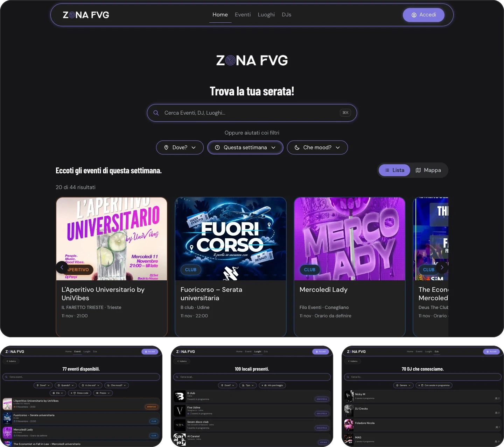

<h1 align="center">Hi, I'm Kris 👋</h1>

  

  I like taking an idea all the way to something people actually open on their phone: the database, the website, the native apps and the server underneath.
   
  Right now that idea is <b><a href="https://zonafvg.it">Zona FVG</a></b>.

 

  <a href="https://zonafvg.it">
    <picture>
      <source media="(prefers-color-scheme: light)" srcset="assets/zona-logo-light.webp">
      
    </picture>
  </a>

  Stop asking "what's on tonight?" 
  The events platform for Friuli Venezia Giulia: concerts, club nights, festivals, venues and DJs.

  
  
  
  
  

  

  
  &nbsp;
  
  &nbsp;
  

 

### What I built in it

I took over an existing WordPress/Voxel site, migrated its data, redesigned the whole product and put it live on **21 September 2026**. Since then it has had roughly 4,800 visits and 12,800 page views, and there are around 1,150 people following it on Instagram. The code is in a private repo, so here is the tour instead.

- **The site.** Search and filter events by place, date, time, mood, age, dress code and price. Venue and DJ pages, a map, saved events, follows and notifications.
- **A dashboard for the people behind the nights.** Owners, venue managers and DJs each get their own permissions, event editing that locks so two people never overwrite each other, collaborations between venues, and analytics.
- **Two native apps.** Swift/SwiftUI for iOS, Kotlin/Compose for Android, no cross-platform layer. Both are built from one written spec and one design-token file, so they behave the same for the user. The iOS app is approved by Apple and about to be released.
- **A social bot.** It reads the public Instagram and Facebook posts of venues and turns them into event drafts I can review, so nobody retypes a flyer.
- **My own analytics.** Visits, searches and page views counted in-house, with no third-party tracker.

A few choices I'm happy with:

- **Security lives in the database.** Roles are read from the `profiles` table, never from token claims, and every table has Row Level Security before it is ever used.
- **Designed from measurements, not guesses.** Every value in the interface comes from a documented design system.
- **No lock-in.** It runs in a container on my own VPS behind Cloudflare, with nothing that only works on one vendor's platform.

 

### Stack

  

Next.js 16 (App Router) · Supabase with Postgres and PostGIS · Tailwind v4 · shadcn/ui · Motion · Turborepo · Coolify

 

### Before Zona

**Ensoul.** I spent almost a year there as an intern. My job was to test and prototype new technologies for the company, including the very first experiments with bringing AI into their workflow.
 

### Say hello

I'm not looking for a job, but I'm always up for an interesting proposal.

  

